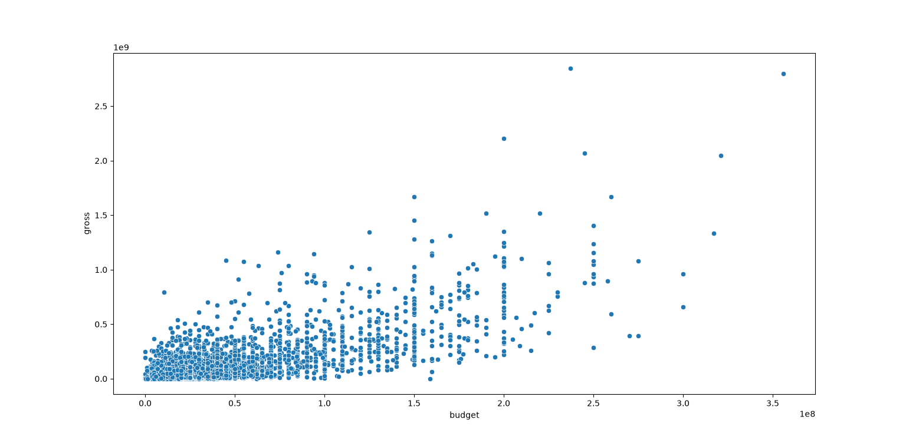
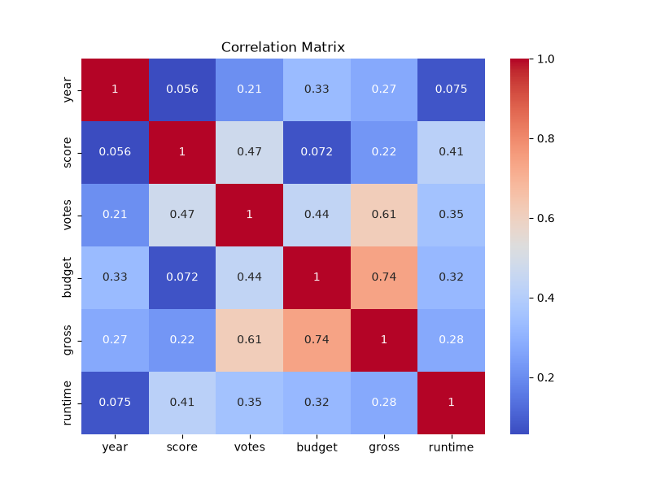
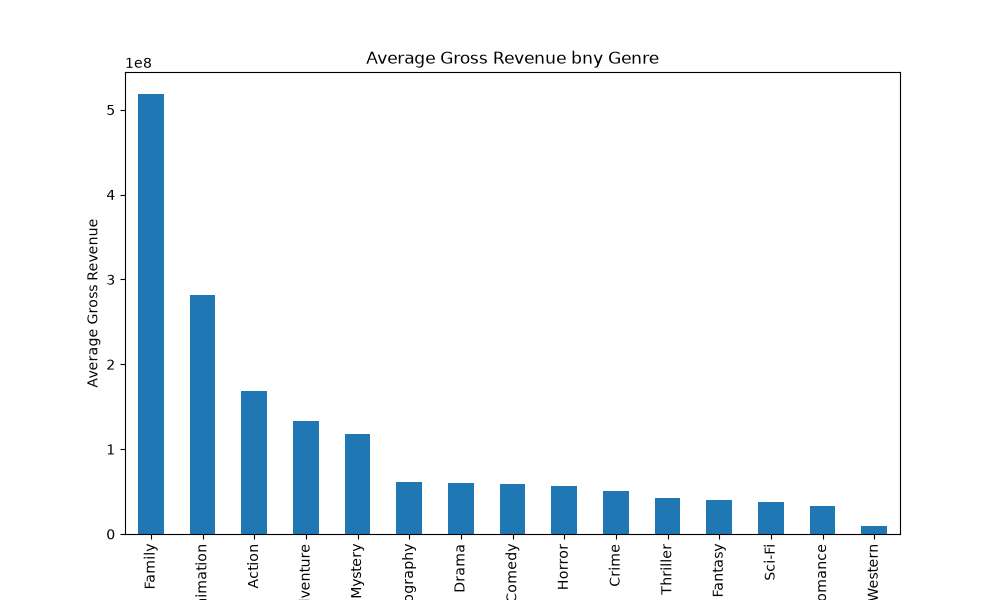
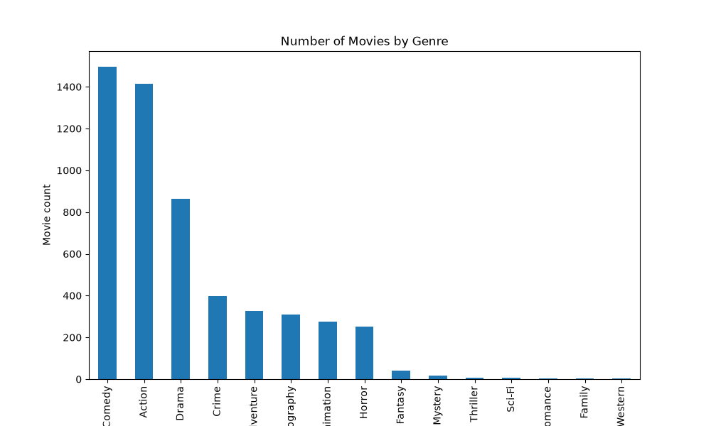

# Movie Correlation Analysis
This project explores the relationship between movie budget, gross revenue and movie genre using Python.

## Scatter Plot
Insight

A positive relationship can be observed between budget and gross revenue.
Movies with larger budgets generally generated higher box office revenue.
However, several outliers can also be observed, suggesting that a high budget does not always guarantee commercial success.

## Correlation Heatmap
Insight

Budget and gross revenue showed the strongest positive correlation (0.74).
This indicates that production budget is one of the most important factors associated with movie revenue.

## Genre Analysis
Insight

Family movies showed the highest average gross revenue.
However, further investigation revealed that only four Family movies remained after data cleaning.
Therefore, the result should be interpreted with caution.

## Genre Distribution
Insight

The dataset is highly imbalanced across genres.
Comedy and Action contain over 1,400 movies each, while Family contains only four movies.
This sample size difference may affect genre-level comparisons.
